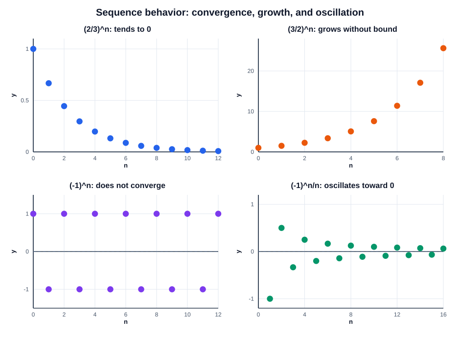

# Exercise 4 — Powers and Oscillation

## Problem Statement

Analyze the behavior of

$$
\left(\frac23\right)^n,\qquad
\left(\frac32\right)^n,\qquad
(-1)^n,\qquad
\frac{(-1)^n}{n}.
$$

## Step-by-Step Solution

### Step 1 — Base between $0$ and $1$

When $0<r<1$, successive powers of $r$ decrease toward $0$. Since $\frac23$ is between $0$ and $1$,

$$
\lim_{n\to\infty}\left(\frac23\right)^n=0.
$$

This sequence converges to $0$.

### Step 2 — Base greater than $1$

When $r>1$, its positive powers grow without bound. Hence

$$
\lim_{n\to\infty}\left(\frac32\right)^n=+\infty.
$$

This sequence diverges to positive infinity.

### Step 3 — Alternating values of fixed size

The sequence $(-1)^n$ alternates between $-1$ and $1$. Its even-indexed terms are $1$, while its odd-indexed terms are $-1$. These subsequences have different limits, so the sequence does not converge.

### Step 4 — Alternating values with shrinking size

The sign still alternates, but the absolute value tends to zero:

$$
\left|\frac{(-1)^n}{n}\right|=\frac1n\longrightarrow0.
$$

By comparison, the sequence itself tends to zero:

$$
\lim_{n\to\infty}\frac{(-1)^n}{n}=0.
$$

The plots show the difference between persistent oscillation and oscillation whose magnitude shrinks:

## Final Answer

- $\left(\frac23\right)^n$ converges to $0$.
- $\left(\frac32\right)^n$ grows without bound.
- $(-1)^n$ oscillates and does not converge.
- $\frac{(-1)^n}{n}$ oscillates with decreasing magnitude and converges to $0$.

## Key Takeaways

- Oscillation alone does not determine convergence; the size of the terms matters.
- If the absolute values tend to zero, the terms themselves tend to zero.