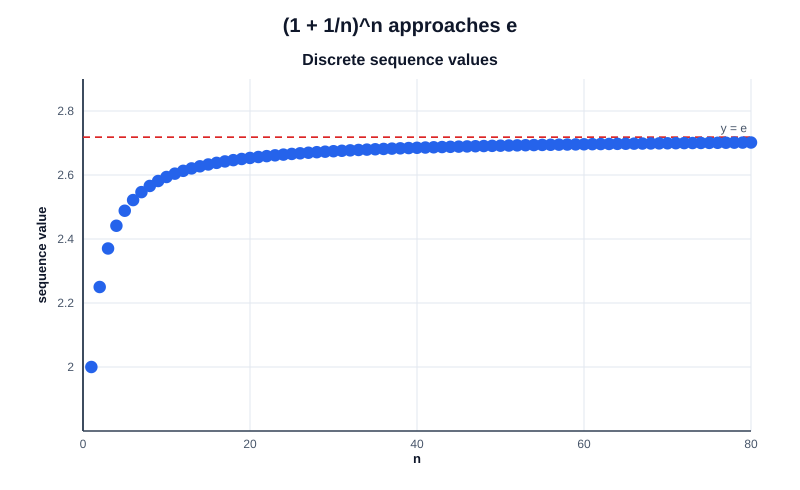

# Exercise 5 — The Classical Limit Leading to the Number $e$

## Problem Statement

Compute

$$
\lim_{n\to\infty}\left(1+\frac1n\right)^n
$$

Calculate several terms for increasing values of $n$ and compare their behavior with the limiting value. Explain why a few numerical values do not constitute a proof of the limit.

## Step-by-Step Solution

### Step 1 — Calculate sample values

Some terms of the sequence are

| $n$ | $\left(1+\frac1n\right)^n$ |
|---:|---:|
| $1$ | $2$ |
| $2$ | $2.25$ |
| $5$ | $2.48832$ |
| $10$ | approximately $2.59374$ |
| $100$ | approximately $2.70481$ |
| $1000$ | approximately $2.71692$ |

These values approach the number $e\approx2.71828$.

The graph shows additional sequence terms approaching the horizontal line $y=e$:

### Step 2 — Establish the limit

Let

$$
a_n=\left(1+\frac1n\right)^n.
$$

Taking natural logarithms gives $\ln a_n=n\ln(1+\frac1n)$. For $u>0$, the standard logarithm inequalities

$$
\frac{u}{1+u}\leq\ln(1+u)\leq u
$$

give, with $u=\frac1n$,

$$
\frac{n}{n+1}
\leq n\ln\left(1+\frac1n\right)
\leq1.
$$

Both bounds tend to $1$, so the squeeze theorem gives $\ln a_n\to1$. By continuity of the exponential function,

$$
a_n=\exp(\ln a_n)\longrightarrow \exp(1)=e.
$$

### Step 3 — Interpret the numerical evidence

The table supports the limit but does not prove it: a finite list cannot establish what happens for every sufficiently large $n$. The logarithm inequalities provide the proof by controlling all terms beyond the listed examples.

## Final Answer

$$
\lim_{n\to\infty}\left(1+\frac1n\right)^n=e.
$$

## Key Takeaways

- Numerical terms can suggest a limit and show how slowly it may be approached.
- A proof needs an argument that applies to all sufficiently large indices.