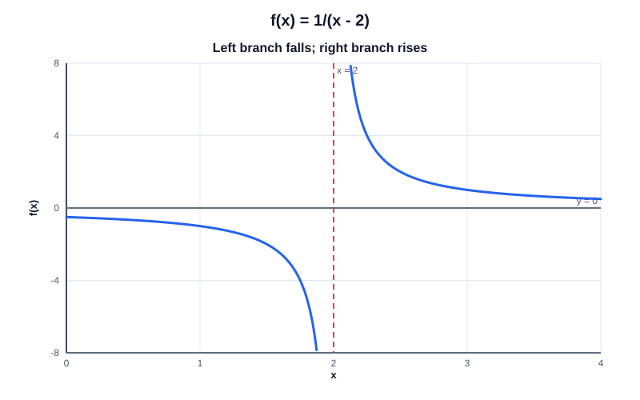

# Exercise 9 — One-Sided Limits and a Vertical Asymptote

## Problem Statement

Analyze the one-sided limits of

$$
f(x)=\frac1{x-2}
$$

as $x\to2$, and identify the vertical asymptote.

## Step-by-Step Solution

### Step 1 — Approach $2$ from the left

When $x<2$, the denominator $x-2$ is negative. As $x$ approaches $2$ from the left, that denominator approaches $0$ through negative values, so its reciprocal decreases without bound:

$$
\lim_{x\to2^-}\frac1{x-2}=-\infty.
$$

### Step 2 — Approach $2$ from the right

When $x>2$, the denominator is positive. As $x$ approaches $2$ from the right, it approaches $0$ through positive values, so the reciprocal grows without bound:

$$
\lim_{x\to2^+}\frac1{x-2}=+\infty.
$$

### Step 3 — Decide whether the two-sided limit exists

The one-sided limits do not agree: one is negative unbounded growth and the other is positive unbounded growth. Therefore the two-sided limit does not exist.

### Step 4 — Interpret the graph

The line $x=2$ is a vertical asymptote. On a sketch, the branch to the left of $x=2$ falls toward $-\infty$, while the branch to the right rises toward $+\infty$.

## Final Answer

$$
\lim_{x\to2^-}\frac1{x-2}=-\infty,
\qquad
\lim_{x\to2^+}\frac1{x-2}=+\infty.
$$

The two-sided limit does not exist, and the vertical asymptote is $x=2$.

## Key Takeaways

- A two-sided limit exists only when the two one-sided limits agree.
- The sign of a denominator approaching zero determines the direction of unbounded growth.