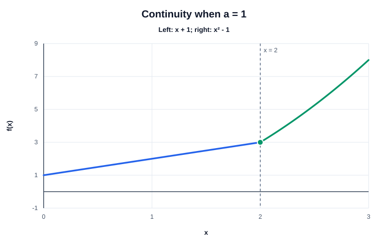

# Exercise 10 — Continuity of a Piecewise Function

## Problem Statement

Find $a$ so that

$$
f(x)=
\begin{cases}
ax+1, & x<2, \\
x^2-1, & x\ge2
\end{cases}
$$

is continuous at $x=2$. Compare both one-sided limits with $f(2)$.

## Step-by-Step Solution

### Step 1 — Compute the left-hand limit

For $x<2$, use the expression $ax+1$:

$$
\lim_{x\to2^-}f(x)
=\lim_{x\to2^-}(ax+1)
=2a+1.
$$

### Step 2 — Compute the right-hand limit and function value

For $x\ge2$, use $x^2-1$. Thus

$$
\lim_{x\to2^+}f(x)
=2^2-1=3,
$$

and because the second branch includes $x=2$,

$$
f(2)=2^2-1=3.
$$

### Step 3 — Enforce continuity

Continuity requires the left-hand limit, right-hand limit, and function value to agree. The right-hand limit already equals $f(2)$, so set the left-hand limit equal to $3$:

$$
2a+1=3
\quad\Longrightarrow\quad
2a=2
\quad\Longrightarrow\quad
a=1.
$$

For this value, all three quantities are $3$.

The graph for $a=1$ shows the two pieces meeting at $(2,3)$:

## Final Answer

$$
a=1.
$$

## Key Takeaways

- At a piecewise boundary, evaluate the left and right branches separately.
- Continuity requires both one-sided limits to equal the function value.