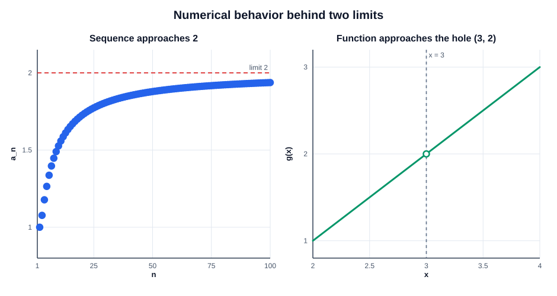

# Exercise 15 — Observation Versus Proof

## Problem Statement

Use a sequence and a function from the set to compare numerical observations with analytical limits, and explain why tables and sketches are not proofs.

## Step-by-Step Solution

### Step 1 — Choose a sequence and calculate terms

Use the sequence from Exercise 1:

$$
a_n=\frac{4n^2-3n+1}{2n^2+5n-7},
\qquad
\lim_{n\to\infty}a_n=2.
$$

Some terms are

| $n$ | $a_n$ |
|---:|---:|
| $10$ | approximately $1.52675$ |
| $100$ | approximately $1.93730$ |
| $1000$ | approximately $1.99352$ |

These values move closer to $2$ as $n$ increases.

### Step 2 — Choose a function and approach from both sides

Use the function from Exercise 7. For $x\ne3$, factor and cancel:

$$
g(x)=\frac{x^2-4x+3}{x-3}
=\frac{(x-1)(x-3)}{x-3}
=x-1.
$$

Thus

$$
\lim_{x\to3}g(x)=2.
$$

Values approaching from the left and right are

| Side | $x$ | $g(x)$ |
|:---|---:|---:|
| Left | $2.9$ | $1.9$ |
| Left | $2.99$ | $1.99$ |
| Left | $2.999$ | $1.999$ |
| Right | $3.1$ | $2.1$ |
| Right | $3.01$ | $2.01$ |
| Right | $3.001$ | $2.001$ |

The values approach $2$ from both sides.

### Step 3 — Describe the sketches

For the sequence, plot the discrete points $(n,a_n)$; the points approach the horizontal level $y=2$ as $n$ increases. For the function, the graph is the line $y=x-1$ with a missing point at $(3,2)$, because the original expression is undefined at $x=3$. The nearby graph values approach the missing point from both sides.

### Step 4 — Distinguish observation from proof

A finite table only checks finitely many inputs, and a sketch cannot verify behavior for every value arbitrarily close to a limit point. The analytical arguments establish the limits: divide by $n^2$ for the sequence, and cancel the common factor for the function.

## Final Answer

The selected sequence and function both have limit $2$:

$$
\lim_{n\to\infty}\frac{4n^2-3n+1}{2n^2+5n-7}=2,
\qquad
\lim_{x\to3}\frac{x^2-4x+3}{x-3}=2.
$$

## Key Takeaways

- Tables and sketches help build intuition but show only selected values.
- A proof needs an argument that controls all sufficiently large indices or all points sufficiently close to the limit point.